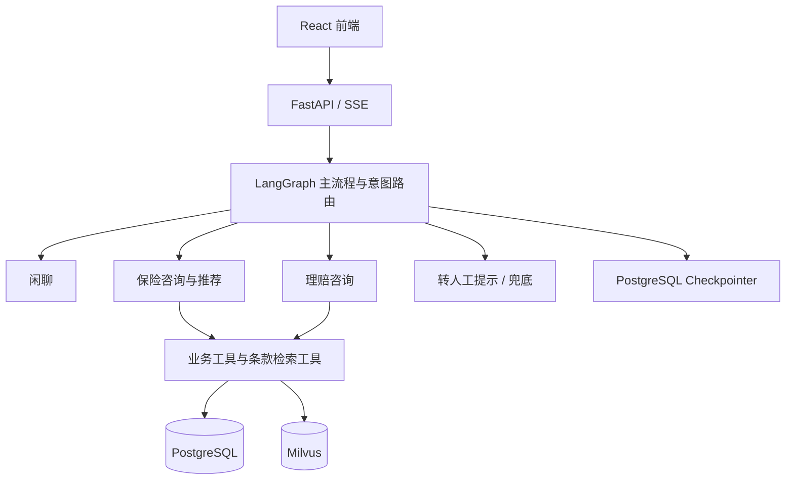

# 安心保 · 保险智能顾问

基于 FastAPI、LangChain 和 LangGraph 的保险咨询与理赔演示项目，前端采用 React、TypeScript 和 Ant Design。通过 Agent 工具调用检索保险条款，结合产品信息、用户保单与理赔记录提供回答。

## 功能

- **产品浏览**：按医疗险、重疾险、寿险和意外险分类、分页查询产品。
- **保险顾问**：查询候选产品、解答条款问题、推荐保险组合。
- **方案确认**：保存方案前通过 LangGraph `interrupt` 暂停，用户确认后继续执行。
- **理赔咨询**：查询当前演示用户的保单、理赔进度及理赔材料说明。
- **多轮会话**：创建、重命名、删除会话，恢复历史消息与引用信息。
- **流式回答**：通过 SSE 返回文本、条款来源及方案确认事件。

当前为学习与演示版本，具体边界见文末「当前限制」。

## 技术架构

| 层次 | 技术 | 职责 |
| --- | --- | --- |
| 前端 | React 18、TypeScript、Vite 6、Ant Design 5 | 产品页面、聊天、引用展示和方案确认 |
| 接口服务 | FastAPI、Pydantic、Uvicorn | HTTP 接口、参数校验及 SSE |
| AI 组件 | LangChain、DeepSeek | 模型调用、工具定义与子 Agent |
| 流程编排 | LangGraph | 意图路由、会话状态及人工确认中断 |
| 关系数据库 | PostgreSQL 16、SQLAlchemy、psycopg | 业务数据、父知识块和 Checkpointer |
| 向量检索 | Milvus、BM25、Qwen3-Embedding | 稠密与稀疏混合检索 |
| 文档处理 | MinerU、Markdown 标题切分器 | PDF 解析及父子块构建 |
| 模型服务 | Ollama、阿里云 DashScope | 本地 Embedding 与云端重排序 |

仓库中的 Compose 当前指定 **Milvus 3.0.0** 和 Attu `v3.0.0-beta.6`；请以配置文件及锁文件为准。



`State` 承载消息、工作流与引用信息；Checkpointer 按 `thread_id` 保存和恢复状态。项目没有实现独立的跨会话长期记忆 Store。

## Agentic RAG

### 离线建库

1. 从产品表读取条款文件名，在 `agent-service/data/raw/kb/` 定位 PDF。
2. 使用 MinerU 解析，再调用聊天模型整理 Markdown 标题结构。
3. 按一至四级 Markdown 标题切分父块，保存在 PostgreSQL。
4. 将父块继续切成目标大小 500 字符、目标重叠 50 字符的子块，并补充章节标题。标题前缀会增加最终长度。
5. 子块保存 `product_id` 和 `parent_id`，通过 Ollama 的 `qwen3-embedding:0.6b` 生成 1024 维稠密向量；Milvus 内置 BM25 生成稀疏表示，使用中文分析器。

解析后存在模型整理步骤，入库前应核对数值、表格与免责条款是否忠实于原文。

### 在线问答

Agent 按需调用 `query_product_clause` 工具：按 `product_id` 限定范围，混合检索子块，使用 DashScope `gte-rerank-v2` 重排序，再按 `parent_id` 去重并批量回取父块。模型根据父块回答，工具同时输出文档名、章节路径与 `ref-001` 等引用信息。

与固定「检索 → 生成」的 2-Step RAG 相比，这里由 Agent 决定是否调用及再次调用检索工具。稠密检索侧重语义相似度，BM25 侧重词项匹配；父子块用于兼顾检索粒度和回答上下文。

## 目录结构

```text
hm-insurance/
├── agent-service/
│   ├── app/
│   │   ├── agents/          # 意图路由、子 Agent、业务与检索工具
│   │   ├── core/            # 配置、日志、异常
│   │   ├── infra/           # 数据库与 Checkpointer
│   │   ├── modules/         # 产品、聊天、方案、保单和理赔模块
│   │   └── rag/             # 建库、检索和父块持久化
│   ├── data/raw/kb/         # 保险条款 PDF
│   ├── data/raw/rate_tables/# 费率表资料
│   └── scripts/ingest_rag.py
├── deploy/
│   ├── docker-compose.yml  # 数据库、向量库及配套服务
│   ├── milvus/             # 重排序凭据配置示例
│   └── postgres/init/      # 表结构和演示数据
└── frontend/               # React 前端
```

## 本地运行

需要 Git、Python **3.14+**、uv、Node.js **20.19+**、npm、Docker Compose 和 Ollama，以及可用的 DeepSeek、MinerU、DashScope 凭据。云端解析、生成与重排序会调用相应外部服务，可能产生费用。

以下命令使用 PowerShell。首次复制配置文件；已有本地配置时直接编辑，避免覆盖。

### 1. 获取代码与配置

```powershell
git clone https://github.com/cbj284/hm-insurance.git
cd hm-insurance
Copy-Item agent-service/.env.example agent-service/.env
Copy-Item deploy/milvus/user.example.yaml deploy/milvus/user.yaml
```

编辑 `agent-service/.env`，填写 `DEEPSEEK_API_KEY` 和 `MINERU_TOKEN`；`CHAT_MODEL` 应使用当前账号可调用、与 DeepSeek 集成兼容的模型名。

在 `deploy/milvus/user.yaml` 的 `credential.dashscope_apikey.apikey` 填入支持重排序服务的 DashScope API Key。该文件和本地 `.env` 均已被 Git 忽略。

| 后端变量 | 默认值 / 说明 |
| --- | --- |
| `APP_NAME` | 必填，示例配置提供应用名称 |
| `APP_HOST` / `APP_PORT` | `127.0.0.1` / `8001` |
| `APP_DEBUG` | `True` |
| `DB_HOST` / `DB_PORT` | `localhost` / `5432` |
| `DB_NAME` / `DB_USER` | `insurance` / `insurance` |
| `DB_PASSWORD` | 与 Compose 中的 PostgreSQL 密码保持一致 |
| `DEEPSEEK_API_KEY` | 聊天模型访问密钥，必填 |
| `CHAT_MODEL` | 当前代码默认 `deepseek-v4-flash`，请核对账号可用模型 |
| `MINERU_TOKEN` | 文档解析 Token，必填 |
| `MILVUS_HOST` / `MILVUS_PORT` | `127.0.0.1` / `19530` |
| `LOGGING_LEVEL` | `INFO` |

后端从 `agent-service/.env` 读取配置。Compose 的变量独立从 shell 或 `deploy/.env` 读取；仅修改后端密码不会同步修改容器配置。默认数据库密码仅用于本地演示。

### 2. 启动基础服务与 Embedding 模型

```powershell
docker compose -f deploy/docker-compose.yml up -d
docker compose -f deploy/docker-compose.yml ps
ollama pull qwen3-embedding:0.6b
```

确保 Ollama 正在运行，默认服务地址为 `http://localhost:11434`；未运行时可在单独终端执行 `ollama serve`。

PostgreSQL 初始化脚本仅在数据卷首次初始化时自动执行。当前脚本创建的 `parent_chunks` 表缺少模型要求的 `clause_name` 字段，新环境需在 PostgreSQL 就绪后执行以下补齐命令；它也适用于已有表。修改过数据库用户名或库名时同步调整参数。

```powershell
docker compose -f deploy/docker-compose.yml exec -T postgres psql -U insurance -d insurance -v ON_ERROR_STOP=1 -c "ALTER TABLE parent_chunks ADD COLUMN IF NOT EXISTS clause_name VARCHAR(300); UPDATE parent_chunks AS pc SET clause_name = p.clause_name FROM products AS p WHERE pc.product_id = p.id AND pc.clause_name IS NULL;"
```

### 3. 安装后端依赖与检查建库入口

```powershell
cd agent-service
uv sync --locked
```

**当前建库入口存在已知阻断**：`scripts/ingest_rag.py` 的 `find_all_products()` 调用了不存在的 `ProductRepository.query_by_category()`。需要先补齐全部有效产品的查询，才能执行下面的命令。已有的 `find_by_category()` 返回 `(products, total)`，且默认分页，不能直接只替换方法名。

修复入口并补齐上述数据库字段后，在 `agent-service` 目录执行：

```powershell
uv run python scripts/ingest_rag.py
```

脚本设计为按产品逐个解析并写入知识库，重新执行会替换对应产品的旧块。它会调用 MinerU、聊天模型与 Ollama；请确认 PDF 文件名与产品表中的 `clause_name` 一致。没有已建好的知识库时，条款检索功能不可用。

### 4. 启动后端

在 `agent-service` 目录执行：

```powershell
uv run python -m app.main
```

- 健康检查：<http://127.0.0.1:8001/health>
- OpenAPI 文档：<http://127.0.0.1:8001/docs>

启动时会检查 PostgreSQL、初始化 Checkpointer，并连接 RAG 组件。基础服务或必要配置不可用时，应用可能无法启动。

### 5. 启动前端

打开新终端，从仓库根目录执行：

```powershell
cd frontend
npm ci
npm run dev
```

访问 <http://localhost:5173>。开发代理默认转发 `/api` 到 `127.0.0.1:8001`；如需调整，复制 `frontend/.env.example` 为 `.env.local` 并编辑其中的地址。

当前 Compose 只编排基础设施，没有前后端应用服务。前端 Dockerfile 可供后续部署集成使用。

## 主要接口

| 方法 | 路径 | 用途 |
| --- | --- | --- |
| GET | `/health` | 服务健康检查 |
| GET | `/api/v1/products` | 产品分类与分页查询 |
| GET | `/api/v1/products/candidates` | 候选产品查询 |
| POST / GET | `/api/v1/chat-threads` | 创建 / 列出会话 |
| GET | `/api/v1/chat-threads/{thread_id}/messages` | 历史消息 |
| PATCH / DELETE | `/api/v1/chat-threads/{thread_id}` | 重命名 / 删除会话 |
| POST | `/api/v1/chat` | SSE 对话或恢复方案确认 |

会话和聊天接口要求 `x-user-id` 请求头。聊天事件包括 `message`、`additional_info`、`interrupt` 和 `done`；以运行中的 OpenAPI 文档及请求模型为准。

## 检查与验证

```powershell
# 从仓库根目录检查 Compose 配置，不输出包含本地凭据的完整配置
docker compose -f deploy/docker-compose.yml config --quiet

# 检查前端 TypeScript 并构建静态资源
cd frontend
npm run build
```

仓库目前未附带自动化测试集、固定问答评测集或性能基准报告，没有可据此声明的检索准确率、首字耗时、并发能力与解析效果指标。配置检查、构建成功也不等于完成端到端验证。

## 当前限制

- 登录为前端演示会话，默认用户 ID 为 `1`；后端使用调用方提供的 `x-user-id`，尚未实现可信的身份认证流程。
- 前端存在投保流程和方案查询入口，但当前后端未注册对应的方案查询与投保状态更新接口；不能作为完整支付、承保链路使用。
- 转人工节点目前仅返回提示，没有连接真实客服系统；保单与理赔查询使用本地演示数据。
- 首次建库需补齐 `parent_chunks.clause_name` 字段，并修复建库脚本调用不存在的产品查询方法的问题；本次文档更新没有修改业务代码。
- 尚未实现完整的 SSE 断点续传、业务级统一重试与工具失败降级策略。
- 父块与子块跨 PostgreSQL、Milvus 写入，不具备跨库原子事务；建库中断后应核对数据并重新构建。
- 仓库附带的 PDF 用作检索演示资料，相关产品名称及条款内容的权利属于对应权利人；本仓库未附带开源许可证。

请在具备正式身份认证、配置管理和业务校验后再考虑对外部署。保险责任与理赔结论以承保机构的有效条款及审核结果为准。
